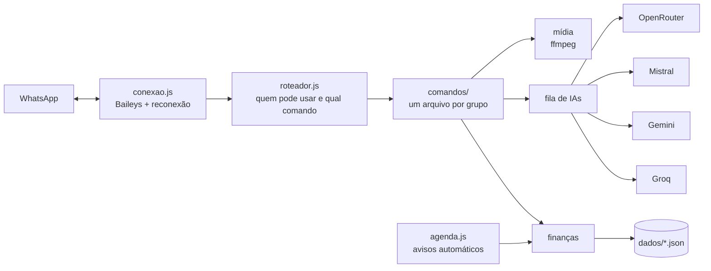

# Assistente para WhatsApp

Assistente pessoal que roda no próprio WhatsApp: controla finanças (cartões, parcelas, metas e limites), entende áudios e comprovantes com IA, faz figurinhas, marca lembretes e manda resumos automáticos. Feito em **Node.js**, roda até num celular Android com **Termux**.


[](https://github.com/G4vo-dev/assistente-whatsapp/actions/workflows/testes.yml)


## Experimente sem WhatsApp

```bash
npm install
npm run demo -- --roteiro   # conversa de exemplo pronta
npm run demo                # converse você mesmo (digite #menu)
```

O modo demonstração roda o bot de verdade no terminal, com um WhatsApp simulado. Os dados ficam numa pasta temporária.

## Exemplo real

Trecho da saída de `npm run demo -- --roteiro` (sem os asteriscos de negrito do WhatsApp):

```text
👤 #despesa 1200 nubank 6x eletronicos celular novo

🤖 🔴 despesa parcelada nº 3 a 8: celular novo
   💸 6x de R$ 200,00 (total R$ 1.200,00)
   🏷️ eletronicos · 📅 de 03/11 até 03/04/2027
   💳 fatura nubank: R$ 200,00 (+ R$ 1.000,00 nos próximos meses)
   💳 limite livre: R$ 800,00 de R$ 2.000,00

👤 #despesa 80 ifood pizza de sexta

🤖 🔴 despesa nº 10 registrada: pizza de sexta · R$ 80,00
   💰 saldo em conta: R$ 3.285,10
   ⚠️ ifood chegou a 83% do limite este mês: R$ 125,00 de R$ 150,00

👤 #grafico

🤖 📊 novembro/2026
   🟢 entrou: R$ 3.500,00
   🔴 saiu: R$ 414,90 (conta R$ 214,90 + cartão R$ 200,00)
   eletronicos ████░░░░  48% R$ 200,00
   ifood       ██░░░░░░  30% R$ 125,00
   mercado     ██░░░░░░  22% R$ 89,90

👤 #sald

🤖 🤔 não conheço #sald. você quis dizer #saldo?
```

## O que ele faz

**💰 Finanças**
- Receitas e despesas com método de pagamento, categoria e data, num formato curto (`#despesa 20 ifood`) ou completo.
- Cartões de crédito com limite, fatura do mês e pagamento de fatura.
- Compras parceladas: uma parcela por mês; a fatura mostra só o mês atual e o limite livre já desconta a compra inteira, como no banco.
- Gastos fixos com vencimento, metas com barra de progresso e limite de gasto por categoria (avisa em 80% e 100%).
- Gráfico do mês por categoria, extrato com filtros e exportação para planilha (CSV).

**🤖 IA**
- `#iagerente`: escreva normal ("gastei 45 no ifood ontem e 120 no mercado no crédito") e a IA lança tudo.
- Áudio na conversa com você mesmo vira texto e, se falar de dinheiro, vira lançamento.
- `#comprovante`: foto, print ou PDF de pagamento vira lançamento.
- Perguntas livres, tradução e dicas financeiras.

**⏰ Automático** (na conversa com você mesmo)
- 9h: contas fixas que vencem no dia · domingo 20h: resumo da semana · dia 1: fechamento do mês · 22h: backup, se algo mudou.

**🎨 Outros**
- Figurinhas de foto, vídeo, gif ou link, com texto embaixo; figurinha de volta para foto.
- Lembretes que sobrevivem a reinícios, clima, CEP, Pokémon e cotações.

## Arquitetura



### Decisões técnicas
- **Fila de IAs com reserva:** cada tarefa tem uma ordem de provedores, começando pelo melhor naquilo (Whisper da Groq para áudio, Gemini para imagem e PDF). Se um falha ou bate no limite do plano grátis, o próximo assume; quem bateu no limite fica "descansando" alguns minutos, respeitando o `retry-after`.
- **Dados sem banco de dados:** arquivos JSON com escrita atômica (arquivo temporário + `rename`), cópia de arquivo corrompido em vez de sobrescrever, backup antes de operações perigosas e migração automática de formatos antigos.
- **Agendador que não perde aviso:** se o bot estava desligado no horário, a tarefa roda quando ele volta, uma vez por dia, com estado salvo em disco.
- **Nunca responde a si mesmo:** o ID de cada mensagem enviada é gerado antes do envio, porque o WhatsApp devolve a própria mensagem antes da resposta da API.
- **Figurinhas leves:** a figurinha animada é refeita com qualidade, fps, tamanho e duração menores até caber no limite de 1 MB do WhatsApp.
- **Privacidade:** só o dono usa por padrão; quem for liberado recebe um aviso de privacidade e mexe só na carteira da própria conversa (`#backup`, `#restaurar` e `#avisos` são só do dono); um modo privado mantém finanças, comprovantes e áudios longe das IAs que usam os dados no plano grátis.
- **Uma cópia só:** uma porta local, liberada sozinha quando o bot cai, impede duas cópias ligadas na mesma pasta; se o WhatsApp avisa que outra cópia assumiu a sessão, o bot para em vez de brigar.
- **Testes sem WhatsApp:** 61 testes com um WhatsApp simulado cobrem finanças, fila de IAs, agenda, backup, privacidade e conversão de mídia com ffmpeg de verdade. O GitHub Actions roda o lint e os testes a cada mudança, no Node 20, 22 e 24.

## Rodando no WhatsApp

1. Node.js 20.19+ e ffmpeg. No Termux: `pkg install nodejs ffmpeg`.
2. `npm install`
3. Copie `.env.example` para `.env` e coloque ao menos uma chave de IA (`GROQ_API_KEY` ou `GEMINI_API_KEY`; ambas têm plano grátis).
4. `npm start`, digite seu número e use o código de pareamento em WhatsApp > Aparelhos conectados > Conectar com número de telefone.
5. Mande `#menu` em qualquer conversa.

No Termux, `npm run iniciar` religa o bot se ele cair e `npm run instalar-boot` liga o bot junto com o celular (app Termux:Boot). Se o bot já estiver ligado, um novo `npm start` avisa e fecha.

Fora da conversa com você mesmo, o bot não responde a comandos que não existem: uma hashtag como `#tbt` num grupo não ganha resposta.

| Comando | Para quê |
|---|---|
| `npm run demo` | conversa com o bot no terminal |
| `npm test` | roda os testes |
| `npm run lint` | confere o padrão do código (ESLint) |
| `npm run modelos` | lista os modelos das IAs com chave |

## Estrutura

```
src/conexao.js        conexão com o WhatsApp, pareamento e reconexão
src/roteador.js       permissões, comandos, modo figurinha e áudio automático
src/agenda.js         avisos automáticos (fixos, resumos, backup)
src/comandos/         comandos, um arquivo por grupo (o #menu se monta sozinho)
src/servicos/ia/      fila de IAs e um arquivo por provedor
src/servicos/         finanças, parcelas, mídia, lembretes e armazenamento
scripts/              demo, religamento automático, Termux:Boot e lista de modelos
test/                 testes com WhatsApp simulado
```

## Avisos

- O bot usa a [Baileys](https://github.com/WhiskeySockets/Baileys), que **não é um cliente oficial** do WhatsApp: o número pode ser suspenso. É um projeto pessoal. Para clientes ou uso comercial, o caminho é a API oficial (WhatsApp Business Platform).
- Privacidade, LGPD e o que vai para cada serviço: [TERMOS-E-PRIVACIDADE.md](TERMOS-E-PRIVACIDADE.md).

## English summary

Personal WhatsApp assistant in Node.js (runs even on an Android phone via Termux): expense tracking with credit cards, installments, budgets and goals; AI features with a provider queue and automatic fallback (Groq, Gemini, Mistral, OpenRouter) for chat, voice notes, receipt photos and PDFs; stickers with ffmpeg; reminders and scheduled summaries. Try it without WhatsApp: `npm install && npm run demo -- --roteiro`. 61 automated tests run against a simulated WhatsApp.

## Licença

[MIT](LICENSE) · feito por [Zet (Gustavo)](https://github.com/G4vo-dev)
